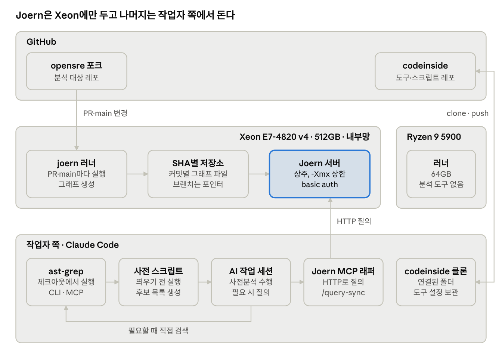
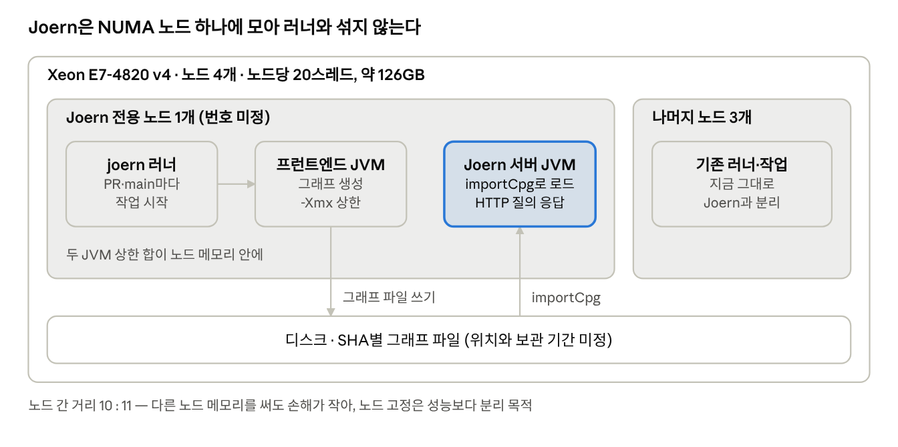
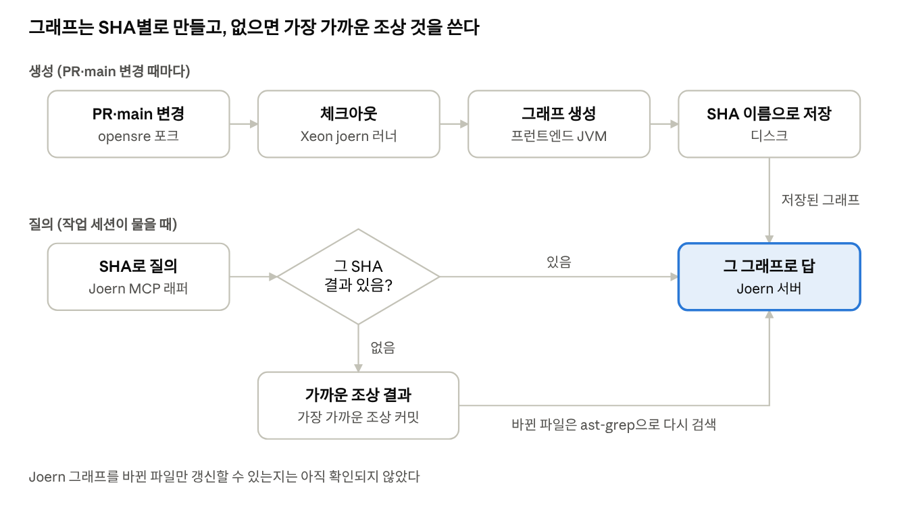
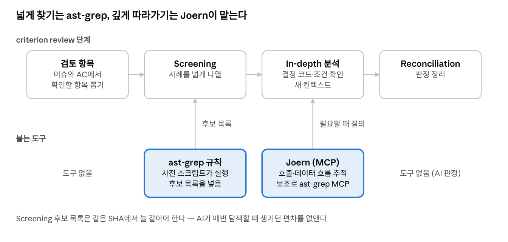
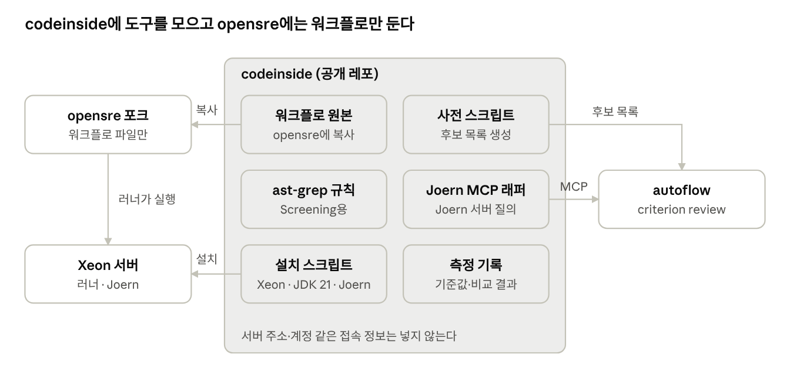

# AI 코드 분석 도구 아키텍처

2026-11-11 · 원본: [claude.ai 문서](https://claude.ai/artifact/2PktctuX9b6wScTJREtxjf). 이 파일은 작업자가 읽을 수 있도록 레포에 넣은 사본이다. 원본이 바뀌면 이 파일도 같이 고친다.

단계별 일정과 남은 결정은 [plan.md](plan.md)에 있다.

## 한눈에 보기

Xeon만 새 역할을 맡고, Ryzen은 지금처럼 러너로만 쓴다.

## Xeon 내부

노드 번호와 `-Xmx` 값은 기준값을 잰 뒤에 정한다.

## 분석 흐름

브랜치 이름이 아니라 커밋 SHA로 찾으므로, 같은 커밋은 언제 물어도 같은 그래프가 답한다.

## criterion review와 도구

도구는 찾기와 따라가기만 맡고, 항목을 뽑고 판정하는 일은 AI가 그대로 한다.

## codeinside 레포 구성

[Munsik-Park/codeinside](https://github.com/Munsik-Park/codeinside)가 도구의 원본이다. 다른 곳에는 복사본이나 호출만 둔다.
