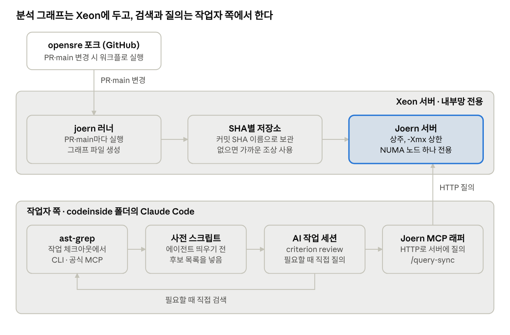

# AI 코드 분석 도구 구축 계획

2026-11-12 · 원본: [claude.ai 문서](https://claude.ai/artifact/DAPVDmG6FzjpyqirLbrQ2e). 이 파일은 작업자가 읽을 수 있도록 레포에 넣은 사본이다. 원본이 바뀌면 이 파일도 같이 고친다.

## 목표와 범위

criterion review에서 코드 탐색을 AI가 매번 하지 않고 결정적인 도구에 맡기는 환경을 만든다. 시험은 opensre 포크에서 하고, 구성은 비공개 코드에도 그대로 쓸 수 있게 사내 서버 안에서만 돌린다.

- 이번 계획: 도구 설치, 기준값 측정, MCP 연결, PR 자동 분석, criterion review 연결까지
- 마지막 단계: llmroute에 적용해 기존 측정과 비교
- 실행은 연결된 codeinside 폴더의 Claude Code 작업자가 맡는다. 이 문서는 그 작업자에게 넘길 계획이다

codeinside 폴더를 GitHub 레포로 만들어 연결하는 일도 범위에 들어간다. 도구 설정, MCP 래퍼, 스크립트, 측정 기록은 모두 이 레포에 둔다.

## 정해진 것

테스트 레포, 분석 서버, 뒤에 붙일 도구 세 개는 정해졌다. 도구 하나로 다 하지 않고, 질문 종류마다 맞는 도구를 뒤에 두고 AI는 MCP로 골라 쓴다. 남은 선택은 마지막 절에 모았다.

| 항목 | 결정 | 근거 |
| --- | --- | --- |
| 테스트 레포 | [Munsik-Park/opensre](https://github.com/Munsik-Park/opensre) 포크 | 공개, Apache 2.0. 거의 Python이고 테스트를 빼면 약 33만 줄. autoflow 이슈 브랜치가 20여 개 있다 |
| 업스트림 연결 | 끊지 않음 | 작업은 내 레포에서만 한다. 포크를 해제하면 이슈와 PR이 사라진다 |
| 분석 서버 | Xeon E7-4820 v4 머신 | 4소켓 40코어(80스레드), 메모리 512GB(바로 쓸 수 있는 양 약 467GB), NUMA 4노드. 이미 러너로 쓰고 있다 |
| Ryzen 9 5900 머신 | 지금처럼 러너로만 씀 | 메모리 64GB. 3단계 측정으로 Xeon만으로 충분하다는 것이 확인됐다 |
| 넓게 찾기(Screening) | ast-grep + 공식 MCP | DB 없이 그때그때 검색한다. MIT |
| 정확한 참조(정의·호출처) | Serena + Pyright(Serena 기본 언어 서버) | Joern은 Python 호출을 이름으로 잇는다(3단계). 타입으로 실제 대상만 찾는다. 흔한 이름에서 Joern 결과 14개 중 실제 호출자는 1개였다(4단계). 앱 GPL-3.0 |
| 깊게 따라가기(In-depth) | Joern | 미리 만든 그래프에서 데이터 흐름과 제어 흐름을 따라간다. Apache 2.0. MCP는 codebadger 시험 뒤 정한다 |
| 앞단 | 도구별 MCP를 나란히 붙임 | 통합 앞단은 AI가 도구 선택을 헷갈리는 게 보일 때 만든다 |
| Java | OpenJDK 21 | Joern README의 요구 버전. Xeon에 설치했다(2단계) |
| 실행 주체 | codeinside 폴더의 Claude Code 작업자 | 작업자가 서버 접속 정보를 갖고 있다 |

## 전체 구조

그래프를 만들고 보관하고 질의를 받는 일은 Xeon이 맡는다. ast-grep 검색과 모든 질의는 작업자 쪽에서 시작한다.

사전 스크립트가 ast-grep 결과로 후보 목록을 만들어 작업 세션에 넣는다. 작업 세션은 더 필요할 때 Serena(정확한 참조)나 Joern(흐름)에 직접 묻는다.

블록도는 [architecture.md](architecture.md)에 따로 있다.

## 구성 요소별 설계

서버가 필요한 건 Joern뿐이다. ast-grep과 Serena는 작업자 체크아웃에서 바로 돈다.

### codeinside 레포

- GitHub 레포는 Munsik-Park/codeinside(공개)이고 연결된 폴더와 이어져 있다(1단계).
- 여기에 둔다: ast-grep 규칙, Serena 설정, Joern MCP 설정 또는 래퍼, 후보 목록을 만드는 사전 스크립트, Xeon 설치·측정 스크립트, 측정 기록.
- opensre 쪽에는 워크플로 파일만 넣고, 실제 작업은 codeinside의 스크립트를 불러서 한다.

### ast-grep

- 작업자 쪽에 설치하고 공식 MCP를 로컬 프로세스로 붙인다.
- 공식 MCP 도구는 구문 트리 보기, 규칙 시험, 패턴 검색, 규칙 검색 4가지다. 스스로 실험 단계라고 밝힌다.
- 저장할 것이 없으므로 SHA별 보관도 필요 없다.
- ast-grep 0.51.2를 쓴다. 공식 MCP는 태그가 없어 커밋으로 고정했다(4단계).
- 사전 스크립트는 CLI 결과를 정렬해 후보 목록을 만든다. 원본 출력은 실행마다 순서가 달라서다. 같은 커밋에서 두 번 돌려 같은 해시가 나왔다(4단계).

### Serena

- 작업자 체크아웃에서 Pyright(Serena 2.1.0 기본값 1.1.403)를 띄워 정의, 참조, 구현을 찾는다. 이름이 같아도 타입으로 실제 대상을 가린다.
- Joern의 Python 프런트엔드는 호출을 이름으로 잇는다. 흔한 이름은 메서드마다 호출 지점이 약 590개씩 붙는다(3단계). 정확한 참조는 Serena가 맡는다.
- 4단계 비교: `record_evidence_entry`는 두 도구가 131쌍 모두 같았다. 흔한 이름인 `SessionManager.close`는 Joern 14개 중 실제 호출자가 1개였고, 실제 호출자 5개 중 Joern이 찾은 것도 1개였다. Joern은 패키지에서 다시 내보낸 이름과 반환 타입 표기를 풀지 못했다.
- 값의 흐름이나 실행 조건은 다루지 않는다. 그건 Joern이 맡는다.
- 코드 편집과 셸 실행 도구도 들어 있으므로 읽기 도구 5개만 켠다. 도구 인터페이스로 고정하고 fixed_tools와 read_only를 함께 건다. REPL 인터페이스에서는 도구 제한이 먹지 않는다(Serena 문서, 4단계 확인).
- 라이선스: 앱은 GPL-3.0, 언어 서버 연결부(SolidLSP)는 MIT. 사내 사용은 문제없고, 고친 버전을 배포하면 소스 공개 의무가 생긴다.

### Joern 서버 (Xeon)

- `joern --server`로 상주시키고 basic auth를 건다. 문서에 "격리가 없다"고 명시돼 있어 내부망에서만 연다.
- 메모리는 부담이 작다. opensre 전체 기준 그래프 생성은 1G로도 되고 적재는 2G부터 된다. 4G나 8G로 올려도 빨라지지 않았다(3단계).
- 메모리 상한은 `JAVA_TOOL_OPTIONS`로 준다. `joern --script`는 JVM을 하나 더 띄우는데 `-J-Xmx`는 그 자식 JVM에 닿지 않는다(3단계 실측). 서버 모드에서도 같은지는 5단계에서 확인한다.
- 프런트엔드(pysrc2cpg)를 따로 돌려 그래프 파일을 만들고 `importCpg`로 올린다.
- NUMA 노드 하나(3단계에서는 노드 3)를 Joern 전용으로 둔다. 메모리 때문이 아니라 러너와 섞이지 않게 하려는 것이다.

### Joern MCP

- 5단계에서 codebadger를 먼저 시험한다. 그래프를 내용 해시로 캐시하고 그래프마다 Joern 서버를 띄웠다 재우는 구조라, 직접 만들려던 것과 거의 같다.
- 확인할 것: 3단계와 같은 커밋·질의(Q1~Q5)에서 같은 결과가 나오는지, 메모리 상한과 NUMA 고정이 먹히는지. Docker, Postgres, Redis가 필요하고 라이선스는 GPL-3.0이다.
- 안 맞으면 Joern 서버에 HTTP로 질의하는 얇은 래퍼를 직접 만든다(`/query-sync`). 3단계 질의 스크립트를 그대로 쓸 수 있다.

### 트리거와 저장

- Xeon 러너에 라벨 하나(예: `joern`)를 붙여 분석 작업만 이 머신으로 보낸다.
- Joern에는 바뀐 파일만 반영하는 기능이 없다(3단계 확인). PR이 열리거나 main이 바뀌면 그래프를 처음부터 다시 만든다. opensre 전체 기준 약 1분(생성 12초, 적재 46초)이다.
- 커밋 SHA 이름으로 저장하고 브랜치는 SHA를 가리키기만 한다. 저장 형태는 생성 결과 파일(30MB, 올리는 데 46초)과 적재된 프로젝트(142MB, 여는 데 약 1초) 중에서 고른다.
- 새 그래프가 만들어지는 동안에는 가장 가까운 조상 커밋의 그래프로 답한다. ast-grep과 Serena는 작업자 체크아웃에서 돌므로 SHA별 보관이 필요 없다.
- 포크에 딸려 온 업스트림 워크플로 14개는 먼저 끈다.

## 단계별 실행 계획

일곱 단계를 순서대로 진행한다. 각 단계는 codeinside의 Claude Code 작업자가 맡고, 끝내는 기준을 만족해야 다음으로 넘어간다.

1. **codeinside 레포 만들기 (완료, PR #1)**
    - 공개 레포 Munsik-Park/codeinside를 연결된 폴더와 이었다. 접속 정보는 올리지 않는다. README, CLAUDE.md, docs를 넣었다.
2. **Xeon 준비 (완료, PR #2)**
    - OpenJDK 21과 Joern v4.0.680을 joern 전용 계정 기준으로 설치했다. 설치 절차는 `scripts/xeon/install-joern.sh`.
3. **기준값 측정 (완료, PR #3)**
    - opensre `a5c1acbd`의 core와 전체로 그래프 생성, 적재, 질의 시간을 재고 부분 갱신 여부를 확인했다. 결과는 측정·검증 표 1~3행과 위험 표에 있다.
4. **ast-grep과 Serena 연결 (완료, PR #5)**
    - ast-grep 0.51.2와 공식 MCP, Serena 2.1.0(Pyright 1.1.403)을 작업자 쪽에 붙였다. Serena는 읽기 도구 5개만 켰다. Screening 규칙 5개와 후보 목록 스크립트를 넣었다. 결과는 위험 표와 [4단계 기록](measurements/2026-11-12-serena-joern/README.md)에 있다.
5. **Joern 서버와 MCP 연결**
    - codebadger를 Xeon에 올려 3단계 Q1~Q5를 다시 돌린다. 결과와 메모리 통제가 맞으면 쓰고, 아니면 얇은 래퍼를 직접 만든다.
    - 끝: 작업 세션에서 MCP로 데이터 흐름을 물어 답을 받는다.
6. **PR 자동 분석**
    - opensre의 업스트림 워크플로를 끄고, Xeon 러너 라벨과 분석 워크플로를 넣는다. 커밋마다 그래프를 새로 만들어 SHA별로 저장하고, 만드는 동안에는 조상 그래프로 답한다.
    - 끝: 시험 PR을 하나 열면 그 SHA의 그래프가 저장되고 MCP로 질의된다.
7. **criterion review 연결과 비교**
    - 작업 에이전트를 띄우기 전에 사전 스크립트가 후보 목록을 넣는다. opensre 정답 사례로 AI 단독 방식과 비교하고, 이어서 llmroute에서 기존 측정과 비교한다.
    - 끝: 측정·검증 표의 4~6행이 채워져 있다.

## 측정·검증 항목

목표는 모든 문제를 찾는 것이 아니라 루프 횟수와 비용을 줄이는 것이다. 성공 기준 숫자는 3단계 측정을 본 뒤에 정한다. 결과 칸은 작업자가 채운다.

| # | 항목 | 재는 것 | 단계 | 비교 기준 | 결과 |
| --- | --- | --- | --- | --- | --- |
| 1 | 그래프 생성 시간 | core와 전체 각각 | 3 | 없음(처음 재는 값) | 프런트엔드: core 4.3초, 전체 11.9초. 적재(`importCpg`)는 전체 기준 약 46초 더 걸림 |
| 2 | 생성 중 최대 메모리와 그래프 크기 | core와 전체 각각 | 3 | 없음 | `-Xmx8G`에서 core 0.78GiB / 4.6MiB, 전체 3.96GiB / 29.7MiB. 전체는 `-Xmx1G`에서도 성공. 적재는 1G에서 OOM, 2G부터 성공(최대 3.60GiB) |
| 3 | 질의 응답 시간 | 호출 관계·데이터 흐름 질의 몇 개 | 3 | 없음 | 호출 관계 3개: 첫 실행 3~73ms, 다시 실행 1ms 안팎. 데이터 흐름 2개: 0.65~1.4초 |
| 4 | 탐지 | 정답 사례에서 동작을 결정하는 코드를 찾은 비율 | 7 | AI 단독. llmroute는 C7 탐지 1/3 | |
| 5 | 비용 | 기록당 비용 | 7 | AI 단독. llmroute는 $1.8–4.6에서 $10–26으로 증가 | |
| 6 | 루프 횟수 | 리뷰에서 재작업으로 돌아간 횟수 | 7 | AI 단독 | |

3행까지의 측정 조건, 명령, 원본 수치는 [measurements/2026-11-11-baseline](measurements/2026-11-11-baseline/README.md)에 있다. 측정 커밋은 opensre `a5c1acbd`, 실행 위치는 NUMA 노드 3이다.

## 확인되지 않은 것과 위험

가장 큰 미확인이던 Joern 부분 갱신은 불가로 확인됐다. 커밋마다 새로 만들어도 약 1분이라 운영에는 문제없다. opensre 규모의 메모리·시간과 Xeon 속도에 대한 걱정은 3단계 측정으로 해소됐다.

| 항목 | 상태 | 대응 |
| --- | --- | --- |
| Joern 부분 갱신 | 없음(3단계 확인) | 커밋마다 새로 만든다. 만드는 동안에는 조상 그래프로 답한다 |
| Joern의 Python 호출 연결 | 이름으로 잇는다(3단계). 흔한 이름은 실제 호출자 5개 중 1개만 맞음(4단계) | 정확한 참조는 Serena가 맡는다. 흔한 이름이나 다시 내보낸 심볼은 Joern 호출 관계를 쓰지 않는다 |
| Python 3.12 `type` 문 파싱 실패 | opensre에서 9개 파일(3단계) | 파일 전체가 빠지지는 않는다. 데모에서 한계로 설명한다 |
| `-J-Xmx`가 스크립트 JVM에 안 닿음 | 3단계 실측 | `JAVA_TOOL_OPTIONS`로 준다. 서버 모드와 codebadger는 5단계에서 확인한다 |
| ast-grep 공식 MCP | 스스로 실험 단계라고 밝힘 | 사전 스크립트는 MCP 없이 CLI를 직접 부른다 |
| Joern 서버 격리 없음 | 문서에 명시 | 내부망 전용, basic auth, 외부 노출 금지 |
| Serena·codebadger 라이선스 | 둘 다 GPL-3.0(Serena는 앱만) | 사내 사용은 문제없다. 고친 버전을 배포할 때만 소스 공개 의무가 생긴다 |
| Serena 편집·셸 도구 | 읽기 도구 5개만 켬(4단계 확인) | 도구 인터페이스, fixed_tools, read_only. 편집·셸 도구를 부르면 Unknown tool로 거부된다 |
| Pyright 가상환경 | opensre 의존성 없이 돌림(4단계) | 서드파티 타입이 풀리지 않는다. 가상환경을 주면 결과가 달라지는지는 확인 안 됨 |
| 작업 세션의 MCP 질의 | 등록과 연결만 확인(4단계) | 5단계에서 Joern MCP와 함께 작업 세션에서 직접 물어 확인한다 |
| opensre 정답지 | 없음 | 지난 autoflow PR에서 사례를 골라 사람이 결정 코드를 확인해 둔다 |
| SHA별 그래프 누적 | 커밋당 30MB(파일) 또는 142MB(프로젝트) | 저장 형태와 보관 개수를 정한다 |

## 남은 결정

5단계 전에 정할 것은 Joern 메모리 상한과 노드 고정이다. 나머지는 진행하면서 정한다.

- [x] codeinside 레포: Munsik-Park/codeinside, 공개로 정함
- [x] 뒤에 붙일 도구: ast-grep, Serena, Joern
- [ ] Joern MCP: codebadger 시험 결과에 따라 (단계 5)
- [ ] Joern 메모리 상한과 노드 고정: 측정상 2G면 적재됨. 여유를 두어 4G, 노드 3 고정을 제안 (단계 5 전)
- [ ] 그래프 저장 형태와 보관 개수: 여는 데 1초인 적재된 프로젝트 저장을 제안 (단계 6 전)
- [ ] opensre 정답 사례로 쓸 이슈·PR (단계 7 전)
- [ ] 통합 MCP 앞단: AI가 도구 선택을 헷갈릴 때 (보류)

## 출처

- [Joern README — JDK 21 요구](https://github.com/joernio/joern)
- [Joern 서버 모드 — 격리 없음, basic auth](https://docs.joern.io/server/)
- [Joern 설치 — 메모리, -Xmx, importCpg](https://docs.joern.io/installation/)
- [ast-grep 공식 MCP — 도구 4개, 실험 단계](https://mcpservers.org/en/servers/ast-grep/ast-grep-mcp)
- [Serena — 앱 GPL-3.0, SolidLSP MIT](https://github.com/oraios/serena)
- [codebadger(Joern MCP) — GPL-3.0, Docker·Postgres·Redis](https://github.com/Lekssays/codebadger)
- [3단계 측정 기록](measurements/2026-11-11-baseline/README.md)
- [4단계 비교 기록 — ast-grep 재현성, Serena·Joern 비교](measurements/2026-11-12-serena-joern/README.md)
- [Serena 설정 — 도구 인터페이스와 REPL](https://github.com/oraios/serena/blob/v2.1.0/docs/02-usage/050_configuration.md)
- [Intel Xeon E7-4820 v4 사양](https://www.intel.com/content/www/us/en/products/sku/93814/intel-xeon-processor-e74820-v4-25m-cache-2-00-ghz/specifications.html)
- [포크 해제 — 이슈·PR 소실](https://docs.github.com/en/pull-requests/how-tos/work-with-forks/detaching-a-fork)
